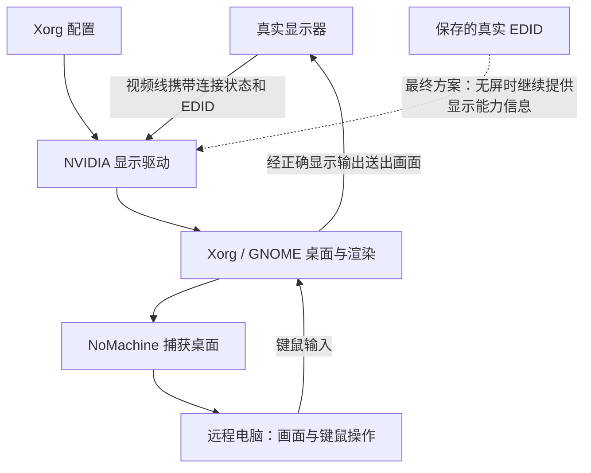
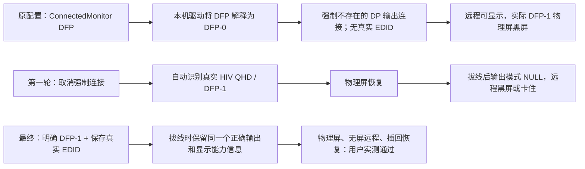

# 系统导图：为什么黑屏，如何修复

适用案例：Orin NX / Jetson Linux R35.6.4 / NoMachine 9.7.3。

EDID 是显示器提供的“支持哪些显示模式”等信息。NoMachine 远程共享桌面依赖可用的桌面渲染；远程能够登录不等于物理视频输出配置正确。

本案例 DFP-0 是 Internal DisplayPort，真实显示器是 DFP-1（Internal TMDS）；xrandr 名称为 DP-1。不能仅凭 DP/HDMI 名称或编号推广到其他载板。

最终保留 AllowEmptyInitialConfiguration，明确指定 ConnectedMonitor DFP-1，并用 CustomEDID 指向从真实显示器采集、校验通过后保存的文件。没有安装新显卡驱动，没有修改内核、设备树、磁盘或网络。

自动恢复期间重新黑屏，是180秒保护机制把配置恢复到测试前；不是证明修复随机失效。通过测试后执行 confirm，停止恢复计时，才算持久保留。

NoMachine 的物理屏黑屏功能已检查为关闭。没有证据证明错误的 Xorg 配置由 NoMachine 添加，因此准确结论是“显示配置问题影响了物理输出和远程无屏渲染”，不是“NoMachine 软件损坏”。

该方案已通过当前机器与显示器的一轮现场插拔验证。其他机器、更换显示器、无屏冷启动、长期运行仍需逐台验收。
